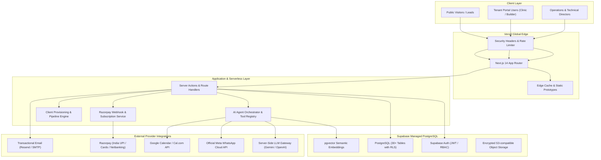

# Tejas AI Systems - Production Architecture Specification

> **Version**: 1.0.0-PROD  
> **Status**: Active Architecture Document  
> **Deployment Target**: Vercel (Web / API / Edge) + Supabase (PostgreSQL / Auth / Storage)

---

## 1. System Topology Overview

Tejas AI Systems operates as an integrated multi-tier enterprise architecture composed of five primary subsystems:

---

## 2. The Five Integrated Subsystems

### Subsystem 1: Public Marketing & Conversion Engine
* **Purpose**: Capture, qualify, and convert local healthcare and real estate prospects in Tirupati and other target cities.
* **Key Components**:
  * Luxury tech dark-navy & cyan design system built with Tailwind CSS.
  * Interactive dual-audience selector (Healthcare vs Real Estate).
  * Live ROI calculator computing real financial leakages for clinics and builders.
  * Embedded sandbox featuring 54 pre-built verified Tirupati business prototypes.
  * Zero-friction lead capture pipeline with rate limiting and CSRF protection.

### Subsystem 2: Multi-Tenant AI Agent Platform
* **Purpose**: Provision, configure, and isolate AI agent workflows for independent business organizations.
* **Tenant Isolation**:
  * Every tenant-owned record contains `organization_id`.
  * Database-enforced Row Level Security (RLS) ensures Tenant A cannot view or modify Tenant B's data under any condition.
  * Role-Based Access Control (RBAC): `platform_owner`, `internal_admin`, `ops_director`, `tech_director`, `org_owner`, `org_manager`, `org_staff`, `read_only`.
* **Agent Lifecycle State Machine**:
  `DRAFT` ➔ `TESTING` ➔ `AWAITING_APPROVAL` ➔ `ACTIVE` ➔ `PAUSED` / `FAILED`.

### Subsystem 3: Secure Customer Portal (`/portal`)
* **Purpose**: Self-service portal for paying clinic and real estate clients.
* **Capabilities**:
  * Real-time lead management, conversation transcripts, and CSV exports.
  * Appointment & site-visit request calendar.
  * Knowledge base file & FAQ manager.
  * Usage metering (tokens, messages, active hours).
  * Invoices, billing statements, and subscription controls.
  * Support ticketing with SLA tracking.

### Subsystem 4: Internal Agency CRM & Automation (`/admin/crm`)
* **Purpose**: Enable the Operations Director (wife) and Technical Director (husband) to manage leads, proposals, and automated onboarding.
* **Pipeline Stages**:
  `NEW` ➔ `CONTACTED` ➔ `QUALIFIED` ➔ `DEMO_BOOKED` ➔ `PROPOSAL_SENT` ➔ `NEGOTIATION` ➔ `WON` / `LOST`.
* **Automated Proposal Generator**: Generates customized PDF/Web proposals based on package rules.
* **Client Onboarding Workflow Engine**: Triggers workspace creation, WhatsApp configuration, questionnaire dispatch, and deployment tasks upon a deal being marked `WON`.

### Subsystem 5: Owner Command Centre (`/admin`)
* **Purpose**: Live operational intelligence and executive financial overview.
* **Live Metrics**:
  * Monthly Recurring Revenue (MRR), cash collected, outstanding dues.
  * Active vs paused agents.
  * Direct provider costs (LLM token consumption, WhatsApp conversation fees) and gross margin calculations.
* **Central Exception Queue**:
  * Captures failed webhook events, message delivery drops, provider outages, and calendar sync issues.
  * Includes 1-click retry controls with idempotency protection.

---

## 3. Technology Rationale & Deployment Strategy

| Component | Selected Technology | Architecture Rationale |
| :--- | :--- | :--- |
| **Framework** | Next.js 14 App Router | Hybrid Server-Side Rendering (SSR) + Server Components minimizes client JS bundles while delivering fast SEO on marketing pages. |
| **Language** | TypeScript (Strict) | Enforces type safety across API boundaries, database schemas, and AI tool definitions. |
| **Styling** | Tailwind CSS + Lucide | Fast compilation, accessible UI primitives, zero runtime CSS overhead. |
| **Database** | PostgreSQL via Supabase | Battle-tested relational database with native RLS, ACID transactions, and pgvector for semantic retrieval. |
| **Auth** | Supabase Auth (JWT) | Secure httpOnly session cookies, role claims, and organization-scoped authorization policies. |
| **Billing** | Razorpay (India Core) | Full compliance with Reserve Bank of India (RBI) e-mandate and recurring payment guidelines, supporting UPI, NetBanking, and RuPay. |
| **Hosting** | Vercel | Global CDN, edge rewrites, zero-downtime rollbacks, and native Next.js optimizations. |
