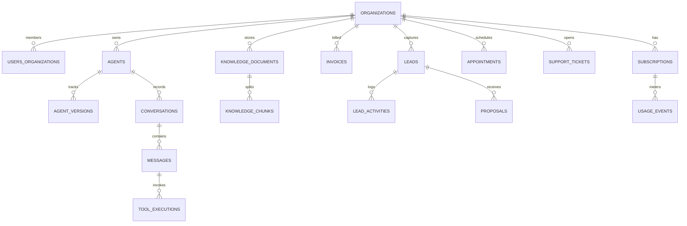

# Tejas AI Systems - Production Data Model & Database Schema

> **Engine**: PostgreSQL 15+ (with `pgvector` & `uuid-ossp`)  
> **Security Pattern**: Strict Row-Level Security (RLS) & Multi-Tenant Foreign Key Constraints

---

## 1. Schema Entity Relationship Overview

---

## 2. Table Definitions & Constraints

### A. Identity, Organizations & Access Control

1. **`users`**
   * `id`: UUID PRIMARY KEY (references `auth.users.id` in Supabase)
   * `email`: VARCHAR(255) UNIQUE NOT NULL
   * `full_name`: VARCHAR(255) NOT NULL
   * `phone`: VARCHAR(32)
   * `is_platform_admin`: BOOLEAN DEFAULT false
   * `created_at`: TIMESTAMPTZ DEFAULT NOW()
   * `updated_at`: TIMESTAMPTZ DEFAULT NOW()

2. **`organizations`** (Tenants)
   * `id`: UUID PRIMARY KEY DEFAULT gen_random_uuid()
   * `name`: VARCHAR(255) NOT NULL
   * `slug`: VARCHAR(100) UNIQUE NOT NULL
   * `industry`: VARCHAR(50) NOT NULL -- 'healthcare', 'realestate', 'general'
   * `city`: VARCHAR(100) DEFAULT 'Tirupati'
   * `address`: TEXT
   * `contact_phone`: VARCHAR(32)
   * `contact_email`: VARCHAR(255)
   * `status`: VARCHAR(32) DEFAULT 'active' -- 'active', 'suspended', 'trial'
   * `created_at`: TIMESTAMPTZ DEFAULT NOW()
   * `updated_at`: TIMESTAMPTZ DEFAULT NOW()

3. **`organization_memberships`**
   * `id`: UUID PRIMARY KEY DEFAULT gen_random_uuid()
   * `organization_id`: UUID REFERENCES organizations(id) ON DELETE CASCADE
   * `user_id`: UUID REFERENCES users(id) ON DELETE CASCADE
   * `role`: VARCHAR(32) NOT NULL -- 'org_owner', 'org_manager', 'org_staff', 'read_only'
   * `created_at`: TIMESTAMPTZ DEFAULT NOW()
   * UNIQUE(`organization_id`, `user_id`)

4. **`invitations`**
   * `id`: UUID PRIMARY KEY DEFAULT gen_random_uuid()
   * `organization_id`: UUID REFERENCES organizations(id) ON DELETE CASCADE
   * `email`: VARCHAR(255) NOT NULL
   * `role`: VARCHAR(32) NOT NULL
   * `token`: VARCHAR(128) UNIQUE NOT NULL
   * `expires_at`: TIMESTAMPTZ NOT NULL
   * `accepted_at`: TIMESTAMPTZ

---

### B. AI Agents & Knowledge Engine

5. **`agent_templates`**
   * `id`: UUID PRIMARY KEY DEFAULT gen_random_uuid()
   * `name`: VARCHAR(128) NOT NULL
   * `industry`: VARCHAR(64) NOT NULL
   * `description`: TEXT
   * `default_prompt`: TEXT NOT NULL
   * `default_tools`: JSONB DEFAULT '[]'::jsonb
   * `version`: VARCHAR(32) DEFAULT '1.0.0'

6. **`agents`**
   * `id`: UUID PRIMARY KEY DEFAULT gen_random_uuid()
   * `organization_id`: UUID REFERENCES organizations(id) ON DELETE CASCADE
   * `template_id`: UUID REFERENCES agent_templates(id)
   * `name`: VARCHAR(128) NOT NULL
   * `purpose`: VARCHAR(255)
   * `status`: VARCHAR(32) DEFAULT 'DRAFT' -- 'DRAFT', 'TESTING', 'AWAITING_APPROVAL', 'ACTIVE', 'PAUSED', 'FAILED'
   * `active_version_id`: UUID
   * `created_at`: TIMESTAMPTZ DEFAULT NOW()

7. **`agent_versions`**
   * `id`: UUID PRIMARY KEY DEFAULT gen_random_uuid()
   * `agent_id`: UUID REFERENCES agents(id) ON DELETE CASCADE
   * `version_number`: INTEGER NOT NULL
   * `system_instructions`: TEXT NOT NULL
   * `permitted_tools`: JSONB NOT NULL DEFAULT '[]'::jsonb
   * `operating_hours`: JSONB
   * `qualification_fields`: JSONB
   * `created_by`: UUID REFERENCES users(id)
   * `approved_by`: UUID REFERENCES users(id)
   * `created_at`: TIMESTAMPTZ DEFAULT NOW()

8. **`knowledge_documents`**
   * `id`: UUID PRIMARY KEY DEFAULT gen_random_uuid()
   * `organization_id`: UUID REFERENCES organizations(id) ON DELETE CASCADE
   * `title`: VARCHAR(255) NOT NULL
   * `source_type`: VARCHAR(32) NOT NULL -- 'text', 'faq', 'pdf', 'website'
   * `file_url`: TEXT
   * `status`: VARCHAR(32) DEFAULT 'pending' -- 'pending', 'processing', 'indexed', 'failed'
   * `token_count`: INTEGER DEFAULT 0
   * `created_at`: TIMESTAMPTZ DEFAULT NOW()

9. **`knowledge_chunks`**
   * `id`: UUID PRIMARY KEY DEFAULT gen_random_uuid()
   * `document_id`: UUID REFERENCES knowledge_documents(id) ON DELETE CASCADE
   * `organization_id`: UUID REFERENCES organizations(id) ON DELETE CASCADE
   * `content`: TEXT NOT NULL
   * `metadata`: JSONB DEFAULT '{}'::jsonb
   * `embedding`: vector(1536) -- pgvector embedding for semantic retrieval

---

### C. Conversations & Tool Execution Logs

10. **`conversations`**
    * `id`: UUID PRIMARY KEY DEFAULT gen_random_uuid()
    * `organization_id`: UUID REFERENCES organizations(id) ON DELETE CASCADE
    * `agent_id`: UUID REFERENCES agents(id) ON DELETE CASCADE
    * `channel`: VARCHAR(32) DEFAULT 'web' -- 'web', 'whatsapp', 'voice', 'api'
    * `external_user_id`: VARCHAR(128) -- Phone number for WhatsApp
    * `status`: VARCHAR(32) DEFAULT 'active' -- 'active', 'escalated', 'closed'
    * `outcome`: VARCHAR(64) -- 'booked', 'inquiry_answered', 'human_escalated'
    * `created_at`: TIMESTAMPTZ DEFAULT NOW()

11. **`messages`**
    * `id`: UUID PRIMARY KEY DEFAULT gen_random_uuid()
    * `conversation_id`: UUID REFERENCES conversations(id) ON DELETE CASCADE
    * `sender_role`: VARCHAR(32) NOT NULL -- 'user', 'assistant', 'system', 'human_agent'
    * `content`: TEXT NOT NULL
    * `tokens_used`: INTEGER DEFAULT 0
    * `created_at`: TIMESTAMPTZ DEFAULT NOW()

12. **`tool_executions`**
    * `id`: UUID PRIMARY KEY DEFAULT gen_random_uuid()
    * `message_id`: UUID REFERENCES messages(id) ON DELETE CASCADE
    * `tool_name`: VARCHAR(64) NOT NULL
    * `arguments`: JSONB NOT NULL
    * `result`: JSONB
    * `execution_time_ms`: INTEGER
    * `status`: VARCHAR(32) -- 'success', 'error', 'denied'
    * `created_at`: TIMESTAMPTZ DEFAULT NOW()

---

### D. Leads, CRM & Sales Engine

13. **`leads`**
    * `id`: UUID PRIMARY KEY DEFAULT gen_random_uuid()
    * `organization_id`: UUID REFERENCES organizations(id) ON DELETE CASCADE
    * `name`: VARCHAR(255) NOT NULL
    * `business_name`: VARCHAR(255)
    * `phone`: VARCHAR(32) NOT NULL
    * `email`: VARCHAR(255)
    * `city`: VARCHAR(100) DEFAULT 'Tirupati'
    * `area`: VARCHAR(100)
    * `industry`: VARCHAR(64)
    * `lead_source`: VARCHAR(64) DEFAULT 'website_demo'
    * `stage`: VARCHAR(32) DEFAULT 'NEW' -- 'NEW', 'CONTACTED', 'QUALIFIED', 'DEMO_BOOKED', 'PROPOSAL_SENT', 'NEGOTIATION', 'WON', 'LOST'
    * `budget`: VARCHAR(64)
    * `assigned_owner_id`: UUID REFERENCES users(id)
    * `notes`: TEXT
    * `created_at`: TIMESTAMPTZ DEFAULT NOW()
    * `updated_at`: TIMESTAMPTZ DEFAULT NOW()

14. **`appointments`**
    * `id`: UUID PRIMARY KEY DEFAULT gen_random_uuid()
    * `organization_id`: UUID REFERENCES organizations(id) ON DELETE CASCADE
    * `lead_id`: UUID REFERENCES leads(id) ON DELETE SET NULL
    * `appointment_type`: VARCHAR(64) -- 'clinic_opd', 'real_estate_site_visit', 'agency_demo'
    * `customer_name`: VARCHAR(255) NOT NULL
    * `customer_phone`: VARCHAR(32) NOT NULL
    * `scheduled_time`: TIMESTAMPTZ NOT NULL
    * `status`: VARCHAR(32) DEFAULT 'scheduled' -- 'scheduled', 'confirmed', 'completed', 'cancelled', 'no_show'
    * `calendar_event_id`: VARCHAR(255)
    * `notes`: TEXT
    * `created_at`: TIMESTAMPTZ DEFAULT NOW()

15. **`proposals`**
    * `id`: UUID PRIMARY KEY DEFAULT gen_random_uuid()
    * `lead_id`: UUID REFERENCES leads(id) ON DELETE CASCADE
    * `title`: VARCHAR(255) NOT NULL
    * `package_name`: VARCHAR(128) NOT NULL
    * `setup_fee`: NUMERIC(10, 2) NOT NULL
    * `monthly_retainer`: NUMERIC(10, 2) NOT NULL
    * `scope_deliverables`: JSONB NOT NULL
    * `status`: VARCHAR(32) DEFAULT 'draft' -- 'draft', 'sent', 'accepted', 'rejected'
    * `created_at`: TIMESTAMPTZ DEFAULT NOW()

---

### E. Billing, Subscriptions & Metering

16. **`plans`**
    * `id`: UUID PRIMARY KEY DEFAULT gen_random_uuid()
    * `name`: VARCHAR(64) NOT NULL
    * `tier_code`: VARCHAR(32) UNIQUE NOT NULL -- 'starter', 'growth', 'premium'
    * `setup_fee_inr`: NUMERIC(10, 2) NOT NULL
    * `monthly_fee_inr`: NUMERIC(10, 2) NOT NULL
    * `token_allowance`: INTEGER NOT NULL
    * `message_allowance`: INTEGER NOT NULL
    * `max_agents`: INTEGER DEFAULT 1

17. **`subscriptions`**
    * `id`: UUID PRIMARY KEY DEFAULT gen_random_uuid()
    * `organization_id`: UUID REFERENCES organizations(id) ON DELETE CASCADE
    * `plan_id`: UUID REFERENCES plans(id)
    * `razorpay_subscription_id`: VARCHAR(128) UNIQUE
    * `status`: VARCHAR(32) DEFAULT 'active' -- 'active', 'past_due', 'cancelled', 'trial'
    * `current_period_start`: TIMESTAMPTZ NOT NULL
    * `current_period_end`: TIMESTAMPTZ NOT NULL
    * `created_at`: TIMESTAMPTZ DEFAULT NOW()

18. **`payments`**
    * `id`: UUID PRIMARY KEY DEFAULT gen_random_uuid()
    * `organization_id`: UUID REFERENCES organizations(id) ON DELETE CASCADE
    * `razorpay_payment_id`: VARCHAR(128) UNIQUE NOT NULL
    * `razorpay_order_id`: VARCHAR(128) NOT NULL
    * `amount_inr`: NUMERIC(10, 2) NOT NULL
    * `currency`: VARCHAR(10) DEFAULT 'INR'
    * `status`: VARCHAR(32) NOT NULL -- 'captured', 'failed', 'refunded'
    * `created_at`: TIMESTAMPTZ DEFAULT NOW()

19. **`usage_events`**
    * `id`: UUID PRIMARY KEY DEFAULT gen_random_uuid()
    * `organization_id`: UUID REFERENCES organizations(id) ON DELETE CASCADE
    * `event_type`: VARCHAR(64) NOT NULL -- 'token_usage', 'whatsapp_message', 'voice_minute'
    * `quantity`: INTEGER NOT NULL
    * `estimated_cost_inr`: NUMERIC(10, 4) DEFAULT 0.0000
    * `idempotency_key`: VARCHAR(128) UNIQUE NOT NULL
    * `created_at`: TIMESTAMPTZ DEFAULT NOW()

---

### F. Support, Auditing & Exception Queue

20. **`support_tickets`**
    * `id`: UUID PRIMARY KEY DEFAULT gen_random_uuid()
    * `organization_id`: UUID REFERENCES organizations(id) ON DELETE CASCADE
    * `title`: VARCHAR(255) NOT NULL
    * `description`: TEXT NOT NULL
    * `priority`: VARCHAR(16) DEFAULT 'medium' -- 'low', 'medium', 'high', 'urgent'
    * `status`: VARCHAR(32) DEFAULT 'open' -- 'open', 'in_progress', 'resolved', 'closed'
    * `assigned_to`: UUID REFERENCES users(id)
    * `created_at`: TIMESTAMPTZ DEFAULT NOW()

21. **`system_exceptions`** (Central Exception Queue)
    * `id`: UUID PRIMARY KEY DEFAULT gen_random_uuid()
    * `organization_id`: UUID REFERENCES organizations(id) ON DELETE SET NULL
    * `source`: VARCHAR(64) NOT NULL -- 'whatsapp_webhook', 'payment_webhook', 'llm_runtime', 'calendar_sync'
    * `severity`: VARCHAR(16) DEFAULT 'medium' -- 'info', 'warning', 'error', 'critical'
    * `error_message`: TEXT NOT NULL
    * `payload`: JSONB
    * `status`: VARCHAR(32) DEFAULT 'unresolved' -- 'unresolved', 'investigating', 'resolved', 'ignored'
    * `retry_count`: INTEGER DEFAULT 0
    * `resolved_by`: UUID REFERENCES users(id)
    * `created_at`: TIMESTAMPTZ DEFAULT NOW()

22. **`audit_logs`**
    * `id`: UUID PRIMARY KEY DEFAULT gen_random_uuid()
    * `organization_id`: UUID REFERENCES organizations(id) ON DELETE CASCADE
    * `actor_user_id`: UUID REFERENCES users(id)
    * `action`: VARCHAR(128) NOT NULL
    * `entity_type`: VARCHAR(64) NOT NULL
    * `entity_id`: UUID NOT NULL
    * `changes`: JSONB
    * `ip_address`: VARCHAR(64)
    * `created_at`: TIMESTAMPTZ DEFAULT NOW()
